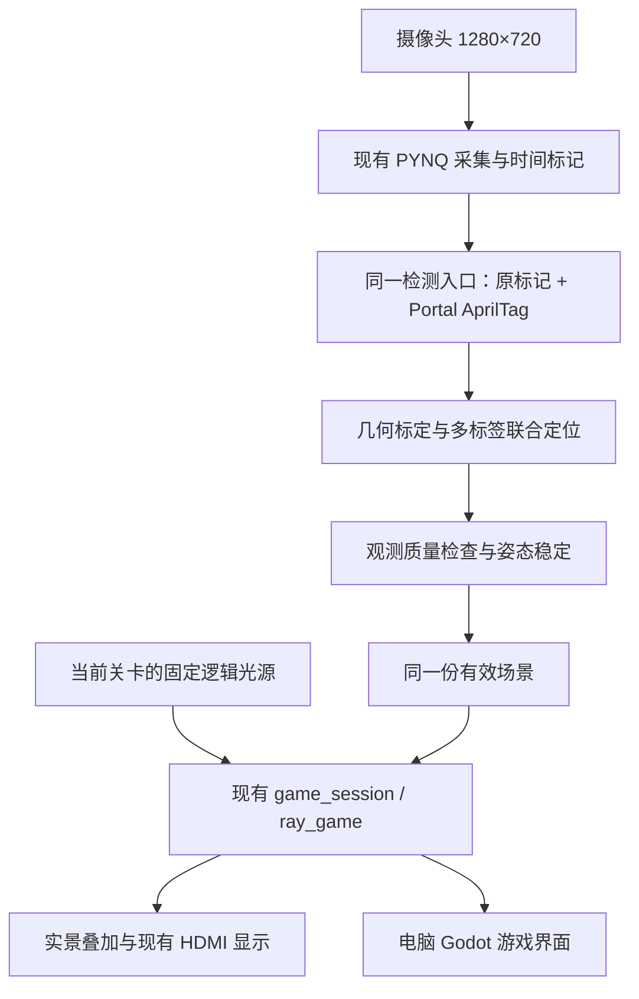

# 实景光路与电脑虚拟游戏最终方案

## 2026-10-27 补充：恢复标记、串口上位机与15格选关

本节覆盖下文的旧标记、三关菜单与部署规划。板端继续使用当前 Standalone/core0 的同一 `vision_ps` restored profile：黄色 Mirror+黑端点，蓝/橙 Portal+白色实心点/圆环，WALL 两端白条，绿色圆 Target。Portal 轴为 solid→ring；Mirror/Wall 的轴按180°等价。电脑串口模式接收板端已确认的中心/轴，不再次识别标签或叠加第二次姿态平滑，也不读取相机原图。

实际入口是 `python -m pc_vision.godot_bridge`：板端检测→原 timed B→POSE2/CRC串口→电脑校时/准入→原 `game_session/ray_game`→本机TCP→现有Godot美术。新增C/Python文件只承担报文和进程桥接，没有复制检测器、求解器或游戏状态机。坐标仍是未标定1280×720相机像素预览；虚拟模型使用唯一JSON的固定尺寸，不能把它们解释为毫米。Godot使用SVG物理锚点及固定尺寸，不随bbox伸缩。

- 选关页5列×3行，共15格，全部显示布局缩略图并可选择；第1～3关沿用 `b206663` 的非SOURCE物体中心/方向及 `sample_photo/075..077.png` 参考。按最新要求，第4～15关用固定随机种子生成物体位置/朝向及固定逻辑光源，并写入同一JSON；Portal成对、物体完整位于画布内，不检查或保证可解。`python -m pc_vision.level_layouts --seed N`可仅重新生成后12关，不能把生成布局当作实际检测输入。
- 三关分别冻结原光源的实际发射点和方向：旧SOURCE质心+方向×(54×2/3+3/100)，转为显式emitter；不再要求实体SOURCE。物体锚点不变，实体允许移动/旋转，不能依靠只转旧SOURCE求解。板端无关卡测试仍为(32,500)向右。
- 板端只发送本帧B确认后的姿态；PENDING/缺失/异常报文不附旧坐标。POSE2明确传递原generation/sequence/captured_ms、published_ms、detector_profile和质量掩码，采用CRC、有界解析、完整场景替换、序号检查。旧scene-v1保留作历史，不用于此入口。
- 电脑发出只读SYNC2 nonce校时；保留整个往返时间给出的映射区间，允许1ms/s的短期时钟漂移估计，5s未更新即失效。整个采集区间必须位于选关/开始之后、当前时刻之前及250ms以内才交给C；计时取区间上界，避免低估用时多给星。原板端时间原样附在快照，接收时间不冒充采集时间。这是软件时钟映射，不是曝光时刻或计量校准。
- C仍负责准备不计时、明确开始后180s、3/2/1星、超时与切关拒绝旧帧。显示保留独立：PENDING至多6s，明确缺失至多250ms，保留原始帧号/时间且变暗；断线立即清空。保留内容从不回送C参与通关。
- 原板端generation/sequence/time完整保留在 `board_frame`。C会话的sequence显式映射为“16位电脑串口连接epoch+48位板端原sequence”，映射范围外拒绝；不是把旧观测重新采集。这样板端重连/重启后可恢复递增输入，计时继续，已结算结果冻结，只有选关请求才重置关卡。C的captured_ms明确为电脑单调时钟映射区间上界。
- 此部署中PC是15关游戏配置的唯一权威；前三关沿用旧布局，后12关是未经可解性验证的随机构图。板端HDMI保留独立无关卡诊断光束及其PortalB单侧出口。它与PC各关固定光源/旧配对规则不是同一局，不称作同步双屏游戏。要让HDMI显示PC同局结果，仍需后续返回权威光段/游戏状态的协议。

源码、host测试、Godot软件/渲染检查和ARM/BOOT打包与板卡实测分别记录；主机测试不能证明实际串口稳定性、B支持间隔或端到端延迟。使用步骤见[Godot说明](godot/README.md)和[Standalone说明](../color_test/software/vision_ps_baremetal/STANDALONE_BEAM.md)。下面是此前方案与历史约束。

> 2026-10-27 最新决定覆盖下文三标签路线：恢复第一版 `b206663` 的彩色旧物块实景光线叠加；恢复前源码已保存于 Git `636f4e5a659b6e3e9266e54385f753759bf0ce75`。运行仍为 Standalone/core0，虚拟光源 `(32,500)` 向右。Mirror 保留黄色主体与黑色端点，Portal 恢复蓝/橙主体与白点/白环，二者均去掉中央白条；WALL 保留白条。使用同一 `vision_ps` 的 restored_markers profile，不链接 AprilTag。保留 timed B 与250ms支持间隔、安全三缓冲和同帧原图/光路提交。PENDING画面保留上限6s、明确缺失上限250ms，显示 STALE/原始帧龄，旧画面不能作为新姿态或通关依据。Portal B 默认沿 solid→ring 轴的正法向固定单侧垂直射出；出口随 B 转动，原配对规则保留给其他调用路径。当前交付仍无菜单/关卡，下面电脑完整游戏及三标签测量是历史/后续方案，不扩大此次恢复范围。构建与验证见 [STANDALONE_BEAM.md](../color_test/software/vision_ps_baremetal/STANDALONE_BEAM.md)。

更新：2026-10-27（实物尺寸与标签记录）。本文是后续实施方案；未把规划中的功能记为已实现或已验收。

> 2026-10-27 最新部署决定：板端实景绘制改为 Standalone 裸板，不再使用 PYNQ/Linux。当前先交付固定光源 `(32,648)` 向右、五类实物交互、原图叠加的最小测试版，不含 KEY/菜单/关卡。继续复用同一 C 检测、几何和光路核心；裸板源码与构建入口见 [STANDALONE_BEAM.md](../color_test/software/vision_ps_baremetal/STANDALONE_BEAM.md)。下文 PYNQ/Linux 架构保留为迁移前记录，不构成当前板端依赖；电脑游戏规划不扩大本次范围。按用户授权已完成ARM编译和BOOT生成，用户负责复制SD及实景上板。此前CSI/VDMA故障根因仍未确定；最近build4停于帧龄拒绝，build5取消该测试门限，尚待实板验收。

## 1. 最终决定

2026-10-27 测试例外：无关卡裸板光束测试的`real_scene.beam.max_age_ms=0`取消250ms帧龄拒绝/停机；保留原始帧标记、同帧原图/模型/光路和DMA安全检查，并显示实际帧龄。完整游戏的250ms规则仍保留。用户日志中的检测耗时1218ms尚未优化，取消门限不代表实时性通过。

同日最新性能决定：用户要求通过PL加快每帧处理并保留B防抖。build5连续输入间隔1299..1799ms，大于B的250ms支持间隔，导致一直重新确认；不切换A或放宽该间隔。build7仅提供AprilTag四阶段分项计时，为选择PL迁移阶段准备证据；尚无PL加速制品或帧率通过结果。当前阶段状态及新BOOT地址见`PROJECT_STATE.md`和`STANDALONE_BEAM.md`。

- 保留同一仓库内的 PYNQ 采集、现有 C/C++ 检测入口、场景适配器、`game_session` 和 `ray_game`。
- 每关使用固定的逻辑光源，直接规定发射点和出射方向；取消实体光源及其识别、定位和方向锁定。光源位置固定，传播光路实时计算。
- 玩家移动或旋转 Mirror、Portal 等实物，摄像头测得其位置和方向，光线随有效物体姿态反射、传送或终止。
- 两个 Portal 已由用户完成三标签改造。软件接入这批标签，其余标记先保留。
- 两种显示：实景画面叠加光路；电脑端绘制完整虚拟游戏。二者读取同一份有效场景和完整光路，不各自推算一套规则。
- **摄像头、游戏逻辑画布、电脑上位机与板端 HDMI 统一 1280×720、16:9。** 1280×800 屏幕使用兼容的 720p 模式并保持比例；在 1280×800 桌面内全屏展示时，上下各留 40 像素。不得把 720 行内容纵向拉伸到 800 行。
- 优先交付稳定定位、准确交互、实时闭环和完整游戏，再完善表现。实景绘制首先指相机画面的叠加显示；若将来需要直接投影到桌面，必须另加投影标定，本方案不假定已有投影设备。

## 2. 系统结构与复用

| 现有部分 | 复用方式 | 需要补齐 |
| --- | --- | --- |
| `pynq_vision/`、`game_capture_worker.py` | 采集、帧传递、单一所有者与安全退出 | 先解决当前连续采集的帧边界故障，恢复可信实时输入 |
| `vision_ps.*` | 同一检测入口、原有 Mirror/Target 等类别 | 接入 AprilTag C 库并输出 Portal 联合姿态，避免另建 Python 检测管线 |
| `game_scene_adapter.*` | 类别、中心、方向、观测有效性与帧标记传递 | 接入真实坐标映射、保留定位质量 |
| `vision_stabilizer.*`、PC 场景管理 | 已有多样本确认、阈值与显示状态 | 修正 Portal 原地旋转限制及无期限保留旧姿态的风险；统一稳定层的位置 |
| `game_session.*`、`ray_game.*` | 唯一权威的关卡、计时、星级、几何求交 | 支持关卡逻辑光源，分开实体检测清单与逻辑发射器 |
| `pc_vision/scene_protocol.py`、`native.py` | 现有有界协议、序号校验、C 会话桥接 | 增补缺失的代际、坐标空间、有效性及需要的质量字段 |
| `pc_vision/godot/` | 已有 720p 菜单、游戏、结算、美术素材及命中火花 | 接入正式 NativeGame 有效场景与状态，补沿光线运动的粒子 |
| `pc_vision/game_config.json` | 唯一手工游戏配置 | 统一实物尺寸、标签局部坐标、有效边界、逻辑光源与 720p 布局 |

配置经既有生成器供 C 与电脑端使用；打印布局文件只作已打印标签的来源记录，不再独立维护另一份运行配置。相机内参与平面标定属于测量数据，必须注明版本和坐标空间。

板端负责摄像头采集和定位，将类别、稳定姿态及质量发给电脑。每个游戏会话只有一个权威 `game_session/ray_game`：板端独立游戏由板端会话负责；电脑主显示模式由现有 PC NativeGame/C 会话负责。若两屏同时展示同一局，两端须消费同一份已提交场景、光段和游戏状态，并由一个会话处理开始、计时和结算。不能让两套独立游戏各自宣布通关。

## 3. 固定逻辑光源

每关保存 `发射点、单位出射方向、所属坐标空间`。进入关卡时加载，整关固定；切关或重新开始时按关卡定义重置。实景叠加与虚拟画面都绘制同一个发射器图标，首段起点与配置发射点一致。

只固定首段的起点和初始方向。之后每一步仍求当前场景中最近的有效交点：Mirror 反射、Portal 配对传送、Target 命中终止、Wall/场景边界终止，并保留现有交互次数与异常处理。

当前 C 会话仍要求 SOURCE 被检测到，部分配置含 `rotate_only` SOURCE。因此不能仅删除实物或画一个固定图标。实施时必须：

1. 把实体必检清单中的 SOURCE 移出，改为明确的关卡逻辑发射器。
2. 在权威会话内把发射器交给现有光路求解器，保留求解器需要的内部 SOURCE 表达；它是关卡数据，不伪装成摄像头观测。
3. 调整缺失对象、开始条件、切关和重置检查。其他必需实物仍须来自可信的新鲜观测。
4. 固定光源不能使缺失、遮挡、旧关卡或过期物体获得通关资格。

取消实体光源后，剩余光路晃动的处理对象是 Mirror/Portal 姿态和场景映射，无需继续设计 SOURCE 方向识别或锁定算法。

## 4. Portal 标记与精确定位

按 2026-10-27 用户最新实测：两个 Portal 外形均为 80×25 mm；使用 `tag36h11 / DICT_APRILTAG_36h11`，每个标签的黑白主体为 12×12 mm。白边与裁切外框不属于标签主体，不由该尺寸推断整张贴纸大小。

| Portal | 左标签 | 右标签 | 偏置标签 |
| --- | --- | --- | --- |
| A | ID 10 | ID 11 | ID 12 |
| B | ID 20 | ID 21 | ID 22 |

用户确认的标签中心相对 Portal 几何中心为 `(-30,0)`、`(+30,0)`、`(0,+6)` mm；局部 +x 从左标签指向右标签，+y 定义为偏置标签所在侧。每个标签的实际朝向仍需与实贴照片核对，运行模板采用这组实测中心及对应朝向；不能强行把粘贴偏差当成检测噪声。最后以整物体刚性模板恢复入口位置和法向。Portal 上没有中心线、圆或圆环识别标记，定位与有向姿态不再依赖旧圆环规则。

定位使用所有可见标签的四角，并按已知局部坐标联合拟合。先去畸变、剔除离群角点，再求整体变换和残差；由整体变换得到物体中心、长轴、入口端点与法向。不要只平均三个标签中心或三个欧拉角。OpenCV 的 Board 方法正是利用已知相对位置和全部角点求共同姿态。[多标记联合定位参考](https://docs.opencv.org/4.x/db/da9/tutorial_aruco_board_detection.html)

桌面平面游戏以 `x、y、平面转角` 为正式游戏输入。若实物厚度造成标签面高于棋盘，应在同一高度标定，或用已标定的多标签 PnP 把物体几何变换到棋盘平面；不能忽略高度后声称边界达到毫米精度。倾斜、抬起导致平面模型不可靠时，先标为受限观测。完整六自由度仅在需要补偿高度/倾斜时用于定位，不必传给二维游戏。

观测质量策略：

- 三个标签：使用 12 个角点联合拟合，正常更新。
- 两个标签：结合标签间距、空间分布和拟合残差判断；质量足够时仍可定位，质量不足则降级。
- 一个标签：可形成单标签估计作为恢复线索；初版按受限观测处理，避免小标签角度误差放大后触发通关。
- 零标签：进入有时限的显示保留，不生成新的可信姿态；超时后明确提示重新定位。

该分级是本项目的保守初版策略，并不表示算法数学上必须看见三个标签。

`tagsize` 使用黑白主体对应的检测角点边长 **12 mm**，以米传入时为 `0.012 m`；白边与裁切尺寸不能代替该值。AprilTag 官方说明以检测角点之间的长度定义该参数。[尺寸定义](https://github.com/AprilRobotics/apriltag#pose-estimation)

使用本次 12 mm 主体的实拍图，先测实际取景中的像素大小、角点残差和遮挡恢复。可用主体约 24–32 像素作为初步画质筛查目标，这是工程试验起点而非识别保证。标签过小时先调整对焦、距离、照明和有效取景面积；把 720p 拉伸到 800 行不会增加信息。

## 5. Mirror、Portal、Wall 与 Target 的边界

目前代码的语义已核对：Mirror 使用有限中心线反射；Portal 使用有向矩形的长侧面传送，端面不传送；Target 使用圆形碰撞。因而“碰到颜色却继续前进”可能来自外观边界与有效边界不重合，不能直接归因为类别识别失败。

每个模型明确区分：实物/美术外轮廓、定位基准、有效交互边界。标签确定姿态，局部几何模板确定边界。两种显示画出同一条有效边界，碰撞直接使用这份几何。

最新实物尺寸以用户实测为准：

| 物体 | 外形与定位标记尺寸（mm） |
| --- | --- |
| Mirror | 外形 80×25；黑点直径 8，中心位于长轴 `(-27,0)`、`(+27,0)`，间距 54；中间白线长 46 |
| Portal A / B | 外形均为 80×25；12×12 标签中心为 `(-30,0)`、`(+30,0)`、`(0,+6)`；没有中心线、圆或圆环识别标记 |
| Wall | 外形 80×25；两端白标记沿长轴的宽度为 9，外缘各离对应短边 5；由此中心位于长轴 `(-30.5,0)`、`(+30.5,0)`，间距 61 |
| Target | 圆形直径 30，半径 15 |

用户已明确否定所给 CAD/模型 ZIP 的尺寸；其中曾测得的 80×20 mm 等数值不能作为运行几何或继续推导模板的依据。参考照片与上述毫米模板的接入仍在实施，全局相机与棋盘平面标定尚未完成，不能据此宣称毫米精度或实时实景闭环通过。

| 物体 | 最终初版边界策略 | 光线行为 |
| --- | --- | --- |
| Mirror | 用实测 46 mm 中间白线登记有限反射段；黑点中心用于恢复物体中心和长轴，80×25 mm 外形不代替反射面 | 入射段精确结束于反射线，再生成反射段 |
| Portal | 保留长侧面传送规则；为两个有效入口侧面登记清楚的有限线段，绘制明显的入口带 | 入射段结束于入口，出口按配对局部坐标产生新段 |
| Wall | 以两端白标记恢复中心和长轴；定位标记不自动变成碰撞面，物体外形与有效边界使用同一份明确模板 | 遇到有效边界后终止 |
| Target | 沿用圆形有效边界，以实测直径 30 mm 统一真实尺寸与中心 | 命中后终止，进入现有通关判定 |

Portal 继续保留类椭圆外观，但 **80×25 mm 外形不自动等于入口碰撞矩形**。先实测能够清楚标出的有效入口长度、横向偏移及对应侧面；它们可以位于外轮廓内。不要把矩形长侧面画在圆弧外，也不要把整个椭圆色块设成可传送面。若要整条椭圆弧都参与传送，那是另一套法向与映射规则，初版不采用。

调试叠加同时显示：原始角点、局部坐标轴、有效边界、最近交点、法向和物体编号。这样可区分定位偏移、边界定义错误、坐标缩放错误和求交错误。光线发光晕可以覆盖少量像素，但表示真实路径的亮芯必须结束于交点。

## 6. 标定、分辨率与坐标一致性

三层坐标保持明确：相机原图像素 `1280×720` → 棋盘物理坐标 `mm` → 统一的 `1280×720` 显示画布。分辨率相同有助于显示一致，但不能取代镜头畸变和透视标定。[相机标定参考](https://docs.opencv.org/4.x/d4/d94/tutorial_camera_calibration.html)

实景模式先在物理平面求光路，再映回相机像素叠加；虚拟模式把同一物理场景等比映射到游戏区域。中心、轴的两个参考点、边界端点、光段和粒子锚点都经过相同的对应变换。透视映射后应重算方向，不能只变中心而沿用原图角度。

统一的具体工作包括：Godot 已有 720p 布局继续复用；把旧 NativeGame 的 1280×800 BGR 画布/接口和旧 800 行菜单、场景布局、鼠标映射按同一配置迁到 720p。当前 `model_sizes` 是历史虚拟单位，Portal `[164,56]` 不能当成实物毫米；改用实测尺寸并明确单位。相机两 lane、RAW10/BGGR 与 1280×720 模式保持既有链路。

游戏 UI 在 720p 内预留顶部状态栏、主要游戏区、底部操作区。所有图层及鼠标采用同一等比视口；屏幕保持 16:9 显示，不压扁模型或拉长圆形 Target。

## 7. 两种防抖方案与选择

两种算法均在可靠的联合定位之后处理，比较同一段原始观测。稳定结果只在一个权威层产生；不叠加板端锁定、PC 再锁定、Godot 再移动模型三层独立滤波。

### A：把微小误差归并为同一姿态——连续自适应滤波

位置和转角先做异常观测剔除，再用 1€ Filter 等速度自适应低通处理：缓慢或静止时抑制抖动，明显移动时降低跟随延迟。角度要解环或处理单位方向向量；Mirror 采用 180° 等价，Portal 保留 ID 定义的有向 360° 姿态。[算法与调参方法](https://gery.casiez.net/1euro/)

该方案的“归并”是连续估计真实姿态，不是把坐标吸附到任意棋盘网格。滤波后仍可能有小变化，优点是转动物体时光线平滑跟随，缺点是稳定与延迟需要折中。

### B：超过阈值才改变——死区、迟滞与时间确认

对比当前测量与最近一次已提交姿态。小于静止阈值时保持已提交姿态；超过较大的移动阈值后，要求候选姿态在短时间内获得可靠支持，再原子提交中心、方向和边界。

位置与角度独立触发，使用 OR 条件；Portal 原地旋转也必须更新。当前 `vision_stabilizer.c` 的 Portal 大变化判定主要依赖位置/尺寸，并有静止翻向抑制，实施时必须修正，不能原样套用。

候选初值可从位置静止阈值约 `0.5–1 mm`、释放阈值约 `1.5–2 mm`，角度约 `0.2–0.5° / 0.8–1°`，确认时间约 `60–120 ms` 开始试验。**这些是待测起点，不是精度承诺**；按真实静止噪声分布和有效观测频率调整。确认按实际时间和新鲜独立观测处理，不能在约 1 Hz 输入下机械等待五帧。

光路对角度很敏感：Mirror 转角误差为 δ 时，反射方向约变化 2δ；距离 L 的位置误差近似 `L·tan(2δ)`。例如 L=500 mm、δ=0.5°，约偏移 8.7 mm。因此阈值必须由边界裕量和可容忍的末端误差反推，不能照搬当前 5°/12° 的历史阈值。

| 对比 | A：连续滤波 | B：阈值提交 |
| --- | --- | --- |
| 静止时 | 显著减小抖动，可能仍缓慢变化 | 死区内完全不动 |
| 拖动、旋转时 | 连续跟随 | 会有保持和提交的跳变 |
| 操作感受 | 适合边移动边观察 | 适合摆好后求解 |
| 主要风险 | 滤波延迟、慢漂移 | 阈值吞掉微调、确认过慢 |
| 实现成本 | 中等 | 低至中等，可改造现有稳定器 |

**建议初版默认 B，同时保留 A 为对比选项。** 游戏以摆放实物求解为主，B 更容易验证“静止光路稳定”。如 A/B 实测显示 B 吞掉必要的角度微调，再选 A，或在单一稳定层内采用“静止锁定、运动滤波”的混合状态机。不要先把两种算法叠加后失去对比依据。

## 8. 虚拟物体闪烁、消失与新鲜度

虚拟物体尺寸读取固定几何模板，位置和转角由同一有效姿态更新，不随每帧检测 bbox 伸缩。模型和光路用同一场景快照原子替换，不能显示新模型配旧光路。

显示保留与游戏有效性分开：短时没有新帧，可以继续显示最近场景；遮挡/陈旧时变暗并提示定位受限；持续丢失后停止可信光路并提示重新定位。保留画面不能更新原始采集时间或触发通关。恢复时做 ID、代际、质量和连续性检查，再采用新的有效场景。

现有 PC 已完成独立 dropout/stale/超时清空与变暗显示，应复用；已有 6 s 是显示保留上限，不代表 6 s 内仍可参与游戏。现有 C 新鲜度门限 250 ms 保持真实含义。每帧保留 `generation、sequence、captured_ms、level_id`，标记语义缺失时升级现有协议；跨设备时间需要明确时钟映射，不把 PC 接收时间当采集时刻。现有 `scene-v1.capture_ms` 实际表示处理开始，不能直接宣称它是曝光时刻；若计算曝光到显示的真实延迟，需要补齐可追溯的原始采集时间。

历史记录约 1.094 Hz 的输入能够解释明显间断。60 FPS 的界面只能让动画顺滑，不能变出更多位置观测。实时更新目标先定为有效场景至少约 10 Hz、争取 15–30 Hz，端到端有效场景年龄留在 250 ms 内并有余量；具体能否达到必须测量。采用最新帧邮箱、限制排队、复用灰度与 ROI，并保留周期性全图重捕获。当前采集故障和处理时间必须实测修复，不能用延长保留期代替。

## 9. 电脑游戏界面与粒子

沿用现有 Godot 美术层，参考 [Portal 2](https://store.steampowered.com/app/620/Portal_2/) 的机关可读性和蓝/橙 Portal 语义，结合 [The Witness](https://store.steampowered.com/app/210970/The_Witness/) 的清楚空间层次与解谜氛围；这是本方案的美术取向，素材继续使用工程已有或原创资源。

菜单包含中文关卡卡片、开始、操作说明和退出；游戏页包含关卡、剩余时间、星级目标、定位状态、重试/跳关/返回；结算显示实际用时、星数与下一关。普通 GameView 继续作调试，正式上位机由 NativeGame 权威状态驱动 Godot。

光线采用稳定亮芯、低强度外晕和沿段运动的小粒子；Mirror 交点有短促火花，Portal 入口/出口有收束和喷出粒子，Target 命中有一次确认效果。复用已有 16 粒、约 0.32 s 的命中火花，再扩展沿光段的装饰。[Godot 2D 粒子参考](https://docs.godotengine.org/en/stable/tutorials/2d/particle_systems_2d.html)

光段保持由 C 求解，粒子只读其端点和有效命中事件。粒子不能跨越 Target、跨过没有配对的 Portal，也不能连出一条穿越两个 Portal 之间空间的实线。旧帧/旧关卡事件拒绝或清除；陈旧状态停止产生成功效果。现有 GL Compatibility 可先使用已验证的粒子与叠加混合，不把切换渲染器作为实现光晕的前提。

## 10. 实施顺序与交付条件

| 工作包 | 主要工作 | 完成依据 |
| --- | --- | --- |
| 实物与几何 | 记录已贴六个标签的实际布局；测量 Mirror 反射面和 Portal 有效入口；相机/平面标定 | 静态照片中定位轴、有效边界与实物一致，原地旋转无跳向 |
| 逻辑光源 | 改唯一配置和 C 会话的 SOURCE 契约 | 无实体光源仍可运行；移动其他物体改变后续光路；缺失实物不可通关 |
| 定位与防抖 | 接入多标签联合定位；分别比较 A/B；修正 Portal 原地旋转与丢失策略 | 同一段观测对比静止抖动、响应延迟、微调能力、遮挡恢复 |
| 连续采集与传输 | 沿现有 capture_worker→C 路径修复当前帧边界问题；接已有场景协议 | 连续新鲜观测进入会话，序号/代际/时间正确，无旧帧排队冒充实时 |
| 共用场景和 720p | 迁移旧 800 行接口与鼠标布局；实景与 Godot 共用有效几何和光段 | 720p 等比显示，边界/模型/光线对齐，点击位置正确 |
| 完整游戏与表现 | 正式 NativeGame 桥接、中文菜单、计时结算、沿段粒子 | 菜单→开始→操作→命中/超时→结算→下一关完整运行 |

这些工作包可按依赖穿插：先用已采集的照片/视频校准几何和比较稳定算法，同时推进既有采集故障；实时闭环恢复后再统一测量端到端效果。不要因美术尚未完成阻塞定位，也不要用美术预览代替实时验收。

验收至少覆盖：静止光路的交点抖动；Mirror/Portal 平移、原地旋转与小角度微调；Portal 单/双标签遮挡和丢失恢复；有效入口内外的擦边；Target 真命中与临近未命中；切关旧帧拒绝；两种显示的一致性；720p 比例与鼠标；连续运行和安全退出。

先进行便宜的静态检查、host 照片/录像回放及 ARM 定向编译，再安排有明确目的的板端验证。当前任务仅制定方案；UART/JTAG/SSH、板端运行、下载、SD/BOOT/PL 修改仍按仓库授权规则另行执行。

计时规则沿用：准备阶段不计时；明确开始后每关 180 s；命中 Target 且用时 `<60 / <120 / <180 s` 分别为 3/2/1 星；超时 0 星；支持跳关，无声音和持久化。完整求解结果和真实有效观测决定通关。

## 11. 当前状态与最小下一步

已知完成：用户已改好 Portal 实物标记；已有六标签打印文件、C 光路与游戏会话、PC 防闪烁显示逻辑、Godot 720p 美术预览与命中火花。

仍需实施：新标签接入检测、实测几何和真实标定、逻辑光源契约、防抖方案比较、旧 800 行接口迁移、正式 Godot 会话桥接，以及连续采集故障的解决与实时验收。贴好标签不等于软件已经识别新标记，美术预览通过也不等于实时游戏通过。

最小下一步：在现有检测入口接入这六个 ID，用实际 Portal 布局拟合姿态并叠加有效入口线；同时先完成固定逻辑光源的离线会话改造。两者通过后，使用同一段实物移动录像对比 A/B，选择默认稳定方式，再进入实时闭环与正式界面集成。
